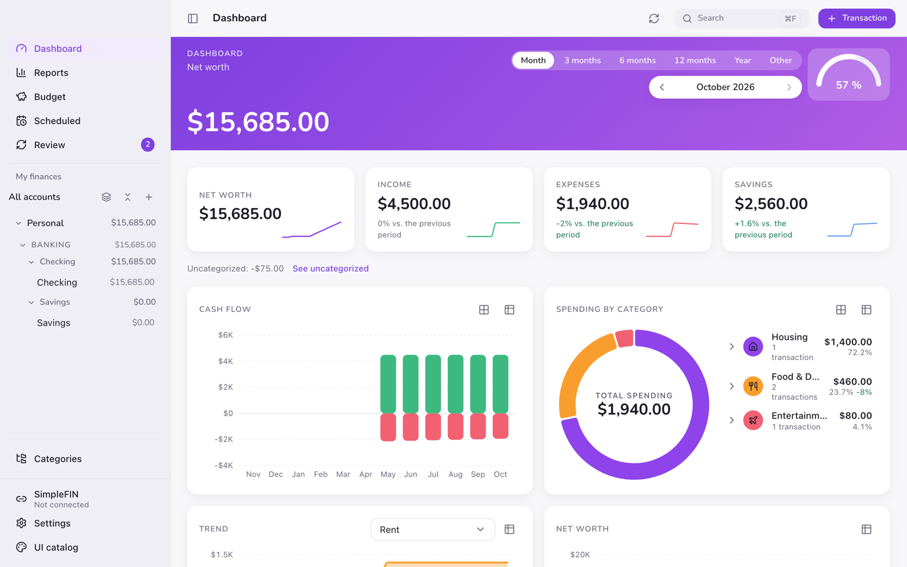
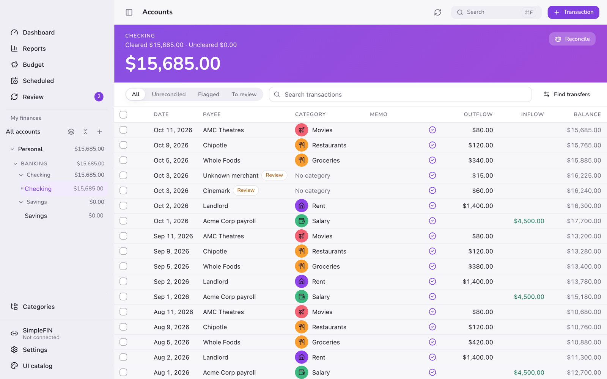
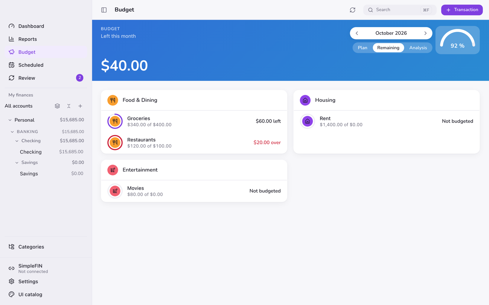
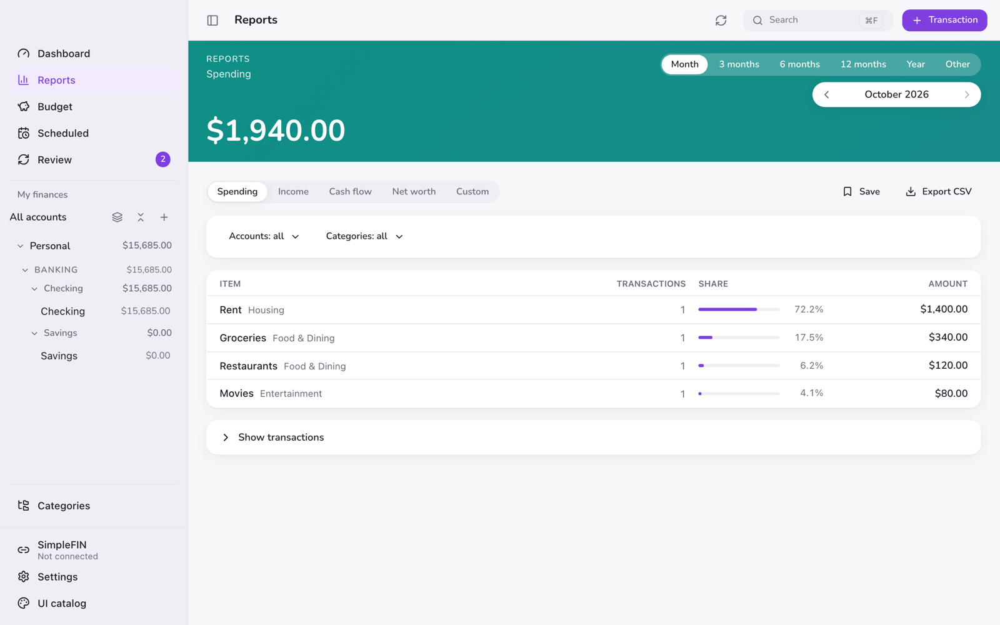

<div align="center">


# SabioFlow

**Personal finance for Mac that lives on your Mac.**<br />
No account. No cloud. No tracking. Just your money, in a file you own.

[**Download for Mac**](https://github.com/zjubiz/sabioflow-releases/releases/latest) &nbsp;·&nbsp; [What's new](https://github.com/zjubiz/sabioflow-releases/releases) &nbsp;·&nbsp; [License](LICENSE)


<br />

<picture>
  <source media="(prefers-color-scheme: dark)" srcset="assets/dashboard-dark.png" />
  
</picture>

</div>

<br />

## Why SabioFlow

Most money apps want your login, your bank credentials and a monthly fee, and then keep your data on their servers. SabioFlow does the opposite.

- 🔒 **Your data stays with you.** Everything lives in a single `.sabioflow` file on your Mac. Back it up, move it, or open it on another Mac like any other document.
- 🔑 **Optional password protection.** Encrypt your file with SQLCipher 4 (AES‑256) and keep the password in your Mac's Keychain.
- 🚫 **No telemetry. No ads. No account.** The app has no analytics and never uploads your data.
- ⚡ **Built to be fast.** A native Mac app (Tauri 2 + Rust) with a register that stays smooth even with years of history.
- ♿ **Accessible by design.** Full keyboard control, light and dark modes, checked against WCAG 2.2 AA.

## What you can do

<table>
<tr>
<td width="50%" valign="top">

### 📒 A register that keeps up with you
Add transactions in a fast inline row (`⌘N`), split them across categories, link transfers between accounts, edit many at once with `⌘E`, and undo mistakes with `⌘Z`.

</td>
<td width="50%" valign="top">

### 🏦 Connect your bank, privately
Sync your accounts through [SimpleFIN Bridge](https://www.simplefin.org/). Your bank connection is stored only in your Mac's Keychain, never in your file and never on our servers.

</td>
</tr>
<tr>
<td valign="top">

### 📥 Bring your history with you
Import CSV, OFX, QFX, QIF and Quicken ZIP files, or just drag a file onto an account. Every import is a batch you can review and undo.

</td>
<td valign="top">

### 🧠 Smart categorization
Rules and suggestions learn from how you categorize. The **Review** inbox catches new, uncategorized and possible transfer transactions.

</td>
</tr>
<tr>
<td valign="top">

### 📊 Reports and a real budget
See where your money goes with spending, income, cash flow and net worth reports. Save the ones you use and export them to CSV.

</td>
<td valign="top">

### 🌎 Multiple currencies
Track accounts in USD, COP, MXN and EUR with automatic exchange rates, or set your own rate by hand.

</td>
</tr>
</table>

Also included: scheduled transactions, tags, attachments, reconciliation, automatic and manual backups, business accounts, global search (`⌘F`) and an interface in **English and Spanish**.

## A closer look

<table>
<tr>
<td width="50%">

<p align="center"><sub><b>Register</b> — fast, keyboard-friendly and always balanced</sub></p>
</td>
<td width="50%">

<p align="center"><sub><b>Budget</b> — see what is left in every category</sub></p>
</td>
</tr>
<tr>
<td colspan="2">

<p align="center"><sub><b>Reports</b> — understand your spending in seconds</sub></p>
</td>
</tr>
</table>

> The screenshots use sample data.

## Download and install

1. Go to the [**latest release**](https://github.com/zjubiz/sabioflow-releases/releases/latest) and download `SabioFlow_<version>_aarch64.dmg`.
2. Open the `.dmg` and drag **SabioFlow** to **Applications**.
3. Open SabioFlow and create a new document, or double‑click an existing `.sabioflow` file.

**Requirements:** a Mac with Apple Silicon (M1 or later) running macOS 13 Ventura or newer. Intel Macs are not supported yet.

### First launch

SabioFlow is not yet notarized by Apple, so macOS asks for confirmation the first time you open it. You only need to do this once:

- **Right‑click** (or `⌃`‑click) **SabioFlow** in Applications, choose **Open**, then click **Open** again.
- If macOS says the app is "damaged", run this in Terminal and open it again:

  ```bash
  xattr -dr com.apple.quarantine /Applications/SabioFlow.app
  ```

## Updates

SabioFlow checks for new versions at most once a day (you can turn this off in **Settings › General**, or check any time from **SabioFlow › Check for Updates…**). It always shows you what changed and **never installs anything on its own**.

Before installing, the app verifies the update's cryptographic signature and makes a backup copy of your open document. The only thing the check downloads is a small public file with the latest version number; nothing about you or your data is sent.

## Privacy

- No analytics, no crash reporting, no accounts.
- Your document never leaves your Mac unless you move it yourself.
- The app only connects to the internet to:
  - fetch exchange rates (it sends only currency codes and dates),
  - sync your bank through SimpleFIN, **if you choose to connect it**, and
  - check for updates.

## License

SabioFlow is proprietary software, **not open source**. This repository contains only release builds and documentation. See [LICENSE](LICENSE) for the terms that apply to using the app.

<br />

<div align="center">
<sub>© 2026 zjubiz. All rights reserved.</sub>
</div>
